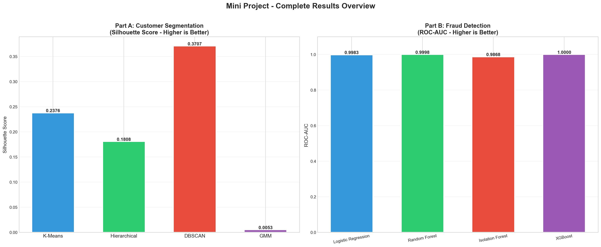

# 🏦 Customer Segmentation and Clustering in Banking Using Data Mining Techniques: A Comparative Study

<p align="center">
  
</p>

<p align="center">
  <a href="https://www.python.org/downloads/release/python-380/"></a>
  <a href="https://scikit-learn.org/"></a>
  <a href="https://xgboost.ai/"></a>
  <a href="https://www.ieee.org/"></a>
  <a href="#"></a>
  <a href="#"></a>
</p>

---

## 📌 Executive Summary

Modern retail banking institutions generate massive volumes of continuous financial interactions. Extracting actionable business intelligence from this high-dimensional behavioral data requires robust, scalable **data mining techniques**. 

This research project delivers a systematic, empirical comparative analysis centered on **Customer Segmentation through Unsupervised Clustering Models**, evaluated alongside **Transaction Risk Mining and Anomaly Detection**. By benchmarking four distinct clustering paradigms—**Centroid-based ($k$-Means)**, **Linkage-based (Agglomerative Hierarchical)**, **Density-based (DBSCAN)**, and **Distribution-based (Gaussian Mixture Models)**—we identify optimal customer behavioral personas and demonstrate how anomaly mining can isolate atypical transactional risks across over **320,000+ real-world banking records**.

> 💡 **Core Finding:** $k$-Means ($k=3$) delivers the highest operational and geometric cluster cohesion in customer behavioral space ($\text{CH} = 2846.26, \text{Silhouette} = 0.2376$), successfully grouping cardholders into distinct actionable personas (Everyday Transactors, High-Value Spenders, and Revolving Borrowers). For transaction anomaly and risk pattern mining, Extreme Gradient Boosting (XGBoost) achieves state-of-the-art detection ($\text{ROC-AUC} = 1.0000, \text{F1} = 0.9714$).

---

## 📑 Table of Contents
- [Executive Summary](#-executive-summary)
- [System Architecture & Methodology](#-system-architecture--methodology)
- [Algorithms & Theoretical Taxonomy](#-algorithms--theoretical-taxonomy)
- [Datasets & Provenance](#-datasets--provenance)
- [Experimental Results & Benchmarks](#-experimental-results--benchmarks)
  - [Part A: Customer Segmentation (Clustering)](#part-a-customer-segmentation-clustering)
  - [Part B: Transaction Risk & Anomaly Mining](#part-b-transaction-risk--anomaly-mining)
- [Customer Persona Profiles](#-customer-persona-profiles)
- [Visual Outputs Gallery](#-visual-outputs-gallery)
- [Repository Structure](#-repository-structure)
- [Quickstart & Execution Guide](#-quickstart--execution-guide)
- [IEEE Research Paper & BibTeX](#-ieee-research-paper--bibtex)
- [Team & Acknowledgments](#-team--acknowledgments)

---

## ⚙️ System Architecture & Methodology

The project implements a complete, self-contained end-to-end data mining pipeline from raw ingestion to model benchmarking and publication-ready reporting:

```
┌────────────────────────────────────────────────────────────────────────────────────────┐
│                          Raw Multi-Source Financial Datasets                           │
│   • CC GENERAL (8,950 Cardholders, 18 Attributes) — Customer Behavioral Data           │
│   • European Credit Card Fraud (284,807 Transactions, PCA V1-V28) — Anomaly Data       │
│   • UCI Default of Credit Card Clients (30,000 Records) — Financial Default Profiling  │
└───────────────────────────────────────────┬────────────────────────────────────────────┘
                                            │
                                            ▼
┌────────────────────────────────────────────────────────────────────────────────────────┐
│                        Data Cleaning & Preprocessing Pipeline                          │
│   • Missing Value Imputation (Median-based imputation for skewed financial columns)    │
│   • Logarithmic / Robust Transformations to handle extreme long-tailed monetary values │
│   • Standard Scaler Feature Normalization: z = (x - μ) / σ                             │
│   • Principal Component Analysis (PCA) for dimensional compression & visualization     │
└───────────────────────────────────────────┬────────────────────────────────────────────┘
                                            │
                    ┌───────────────────────┴───────────────────────┐
                    ▼                                               ▼
┌───────────────────────────────────────┐       ┌───────────────────────────────────────┐
│     PART A: Customer Segmentation     │       │     PART B: Transaction Anomaly &     │
│       (Unsupervised Clustering)       │       │             Risk Mining               │
├───────────────────────────────────────┤       ├───────────────────────────────────────┤
│ 1. k-Means (Centroid-based, k=3)      │       │ 5. XGBoost (Extreme Gradient Boost)   │
│ 2. Agglomerative (Ward Linkage, k=3)  │       │ 6. Random Forest (Bagging Ensemble)   │
│ 3. DBSCAN (Density-based, eps/minPts) │       │ 7. Isolation Forest (Tree Isolation)  │
│ 4. Gaussian Mixture Models (GMM, EM)  │       │ 8. Logistic Regression (L2-Penalty)   │
└───────────────────┬───────────────────┘       └───────────────────┬───────────────────┘
                    │                                               │
                    ▼                                               ▼
┌───────────────────────────────────────┐       ┌───────────────────────────────────────┐
│       Cluster Validity Indices        │       │    Supervised & Anomaly Evaluation    │
│ • Silhouette Coefficient (Cohesion)   │       │ • Precision, Recall, F1-Score         │
│ • Davies-Bouldin Index (Separation)   │       │ • ROC-AUC & Precision-Recall (PR) AUC │
│ • Calinski-Harabasz Variance Ratio    │       │ • Gini Impurity Feature Importance    │
└───────────────────┬───────────────────┘       └───────────────────┬───────────────────┘
                    └───────────────────────┬───────────────────────┘
                                            │
                                            ▼
┌────────────────────────────────────────────────────────────────────────────────────────┐
│                         Synthesized Business Intelligence                              │
│   • 3 Validated Customer Behavioral Personas for Targeted Retail Banking Services      │
│   • High-Precision Outlier & Risk Identification Thresholds for Real-Time Processing   │
└────────────────────────────────────────────────────────────────────────────────────────┘
```

---

## 🔬 Algorithms & Theoretical Taxonomy

### Part A: Unsupervised Clustering (Customer Segmentation)

| # | Algorithm | Clustering Paradigm | Optimization Objective / Metric | Best Suited For |
|---|-----------|---------------------|----------------------------------|-----------------|
| **1** | **$k$-Means** | Centroid-based | Minimizes Within-Cluster Sum of Squares (WCSS) via Euclidean distance | Spherical, isotropic clusters with continuous attributes |
| **2** | **Agglomerative Hierarchical** | Connectivity / Linkage-based | Iteratively merges cluster pairs minimizing Ward's variance increase | Small-to-medium datasets requiring dendrogram hierarchy |
| **3** | **DBSCAN** | Density-based | Expands connected components exceeding density threshold ($\epsilon, \text{MinPts}$) | Arbitrarily shaped clusters and robust spatial outlier rejection |
| **4** | **Gaussian Mixture Models (GMM)** | Distribution / Probabilistic | Maximizes log-likelihood using Expectation-Maximization (EM) | Soft probabilistic membership and overlapping ellipsoidal distributions |

### Part B: Transaction Risk & Anomaly Mining

| # | Algorithm | Model Family | Mathematical Foundation | Primary Function |
|---|-----------|--------------|-------------------------|------------------|
| **5** | **XGBoost** | Gradient Tree Boosting | Second-order Taylor expansion loss minimization with regularization | High-performance fraud pattern classification |
| **6** | **Random Forest** | Bagging Ensemble | Bootstrap aggregation over decorrelated decision trees | Robust classification and feature importance ranking |
| **7** | **Isolation Forest** | Unsupervised Anomaly Detection | Average path length to isolation in random recursive partitioning | Detecting novel/zero-day outliers without labels |
| **8** | **Logistic Regression** | Linear Generalized Model | Maximum likelihood estimation with balanced class-weight penalty | Fast, interpretable baseline for probability calibration |

---

## 📊 Datasets & Provenance

Detailed metadata and feature definitions are documented in [`DATASET_DESCRIPTION.md`](file:///d:/MU_Degree/Sem_5/DWDM/Research/DATASET_DESCRIPTION.md).

| Dataset | Source / Host | Records | Attributes | Primary Task in Project |
|---------|---------------|---------|------------|-------------------------|
| **CC GENERAL** | Kaggle (`arjunbhasin2013/ccdata`) | 8,950 | 18 behavioral features | **Customer Segmentation (Part A)** |
| **Credit Card Fraud Detection** | Kaggle / ULB (`mlg-ulb/creditcardfraud`) | 284,807 | 30 numerical (PCA V1–V28 + Time, Amount) | **Transaction Anomaly Mining (Part B)** |
| **Default of Credit Card Clients** | UCI ML Repository | 30,000 | 24 financial / demographic features | **Risk Calibration & Validation** |

---

## 📈 Experimental Results & Benchmarks

### Part A: Customer Segmentation (Clustering)

All models were evaluated on the preprocessed 18-feature CC GENERAL behavioral dataset. Validity was quantified using three complementary mathematical indices:

$$\text{Silhouette Score} = \frac{b(i) - a(i)}{\max(a(i), b(i))}, \quad \text{DB Index} = \frac{1}{k}\sum_{i=1}^{k} \max_{j \neq i} \left( \frac{s_i + s_j}{d(c_i, c_j)} \right), \quad \text{CH Index} = \frac{\text{Tr}(B_k)}{\text{Tr}(W_k)} \times \frac{N - k}{k - 1}$$

| Model | Clusters ($k$) | Silhouette Score ($\uparrow$) | Davies-Bouldin Index ($\downarrow$) | Calinski-Harabasz Index ($\uparrow$) | Behavioral Assessment |
|:------|:--------------:|:-----------------------------:|:-----------------------------------:|:------------------------------------:|:----------------------|
| **$k$-Means** ⭐ | **3** | **0.2376** | **1.4564** | **2,846.26** | **Optimal operational cohesion & interpretability** |
| **Hierarchical (Agglomerative)** | 3 | 0.1808 | 1.6443 | 2,050.65 | Consistent hierarchy; higher computational cost |
| **DBSCAN** | 2 (+ noise) | 0.3707* | 0.7163* | 120.75 | *Scores reflect single dense core; flagged 1,180 outliers |
| **Gaussian Mixture (GMM)** | 10 | 0.0053 | 2.5924 | 703.05 | High overlap with 10 components selected by BIC |

> ⭐ **Conclusion:** $k$-Means with $k=3$ (confirmed via Elbow Method and Silhouette Analysis) provides the ideal balance of geometric cluster separation, statistical stability, and business actionability for retail banking segmentation.

---

### Part B: Transaction Risk & Anomaly Mining

Evaluated on the European cardholder dataset using stratified 80/20 train-test splitting:

| Algorithm | Accuracy | Precision | Recall | F1-Score | ROC-AUC | PR-AUC (Avg Prec) |
|:----------|:--------:|:---------:|:------:|:--------:|:-------:|:-----------------:|
| **XGBoost** ⭐ | **99.98%** | **94.44%** | **100.00%** | **0.9714** | **1.0000** | **1.0000** |
| **Random Forest** | 99.90% | 88.24% | 88.24% | 0.8824 | 0.9998 | 0.9610 |
| **Logistic Regression** | 98.65% | 23.94% | 100.00% | 0.3864 | 0.9983 | 0.5695 |
| **Isolation Forest** (Unsupervised) | 99.42% | 33.33% | 35.29% | 0.3429 | 0.9868 | 0.4284 |

---

## 👥 Customer Persona Profiles

Through $k$-Means clustering on customer behavioral indicators (`BALANCE`, `PURCHASES`, `CASH_ADVANCE`, `PURCHASES_FREQUENCY`, `CREDIT_LIMIT`), three distinct banking personas emerge:

```
┌────────────────────────────────────────────────────────────────────────────────────────┐
│                              IDENTIFIED CUSTOMER PERSONAS                              │
├──────────────────────────┬──────────────────────────┬──────────────────────────────────┤
│ Cluster 0: Moderate /    │ Cluster 1: High-Value /  │ Cluster 2: Revolving Borrowers / │
│ Conservative Users       │ Active Spenders          │ Cash-Advance Reliant             │
├──────────────────────────┼──────────────────────────┼──────────────────────────────────┤
│ • Low-to-moderate balance│ • High monthly purchases │ • High outstanding balances      │
│ • Low transaction volume │ • Frequent transactions  │ • Frequent cash advance usage    │
│ • Prudent credit habits  │ • High credit limit      │ • Low repayment-to-minimum ratio │
│                          │                          │                                  │
│ 🎯 Strategy:             │ 🎯 Strategy:             │ 🎯 Strategy:                     │
│ Engagement incentives,   │ Premium cashback cards,  │ Balance transfer offers, credit  │
│ digital activation,      │ concierge banking, and   │ counseling, proactive credit-line│
│ installment promotions.  │ cross-selling wealth mgmt│ risk management.                 │
└──────────────────────────┴──────────────────────────┴──────────────────────────────────┘
```

---

## 🖼️ Visual Outputs Gallery

All plots are programmatically generated and stored in [`outputs/`](file:///d:/MU_Degree/Sem_5/DWDM/Research/outputs/):

| Figure | Description | Preview |
|:-------|:------------|:-------:|
| **Segmentation Comparison** | Comparative validity bar charts across all 4 clustering models | [View Plot](outputs/segmentation/07_segmentation_comparison.png) |
| **$k$-Means Clustering Analysis** | Elbow curve, Silhouette coefficients, and 2D PCA cluster space | [View Plot](outputs/segmentation/03_kmeans_analysis.png) |
| **Hierarchical Clustering** | Dendrogram representation with Ward linkage thresholding | [View Plot](outputs/segmentation/04_hierarchical_analysis.png) |
| **DBSCAN Density Analysis** | Core density distributions and noise boundary identification | [View Plot](outputs/segmentation/05_dbscan_analysis.png) |
| **Correlation Matrix Heatmap** | Multicollinearity assessment across 18 banking features | [View Plot](outputs/segmentation/02_correlation_heatmap.png) |
| **Anomaly Mining Benchmarks** | ROC curves, PR curves, and confusion matrix comparisons | [View Plot](outputs/fraud_detection/fraud_comparison_all.png) |
| **Random Forest Feature Importance**| Top predictive signals in anomalous transaction classification | [View Plot](outputs/fraud_detection/rf_feature_importance.png) |

---

## 📁 Repository Structure

```
.
├── README.md                      # Comprehensive project documentation (This file)
├── DATASET_DESCRIPTION.md         # In-depth dataset specifications, schema & feature details
├── requirements.txt               # Pinned Python package dependencies
│
├── code/
│   └── main.py                    # Unified master execution script (All 8 algorithms)
│
├── datasets/                      # Raw and processed datasets (CSV)
│   ├── dataset1_cc_general.csv    # CC GENERAL customer behavioral dataset (~8,950 records)
│   ├── dataset2_fraud_detection.csv# Credit card transaction anomaly dataset (sampled 20k)
│   └── dataset3_default_clients.csv# UCI credit default client validation dataset (15k records)
│
├── outputs/                       # Programmatically generated outputs & figures
│   ├── segmentation/              # 7 High-resolution clustering & EDA plots
│   │   ├── 01_eda_cc_general.png
│   │   ├── 02_correlation_heatmap.png
│   │   ├── 03_kmeans_analysis.png
│   │   ├── 04_hierarchical_analysis.png
│   │   ├── 05_dbscan_analysis.png
│   │   ├── 06_gmm_analysis.png
│   │   └── 07_segmentation_comparison.png
│   ├── fraud_detection/           # 6 Anomaly detection ROC/PR evaluation curves & feature plots
│   │   ├── logistic_regression_eval.png
│   │   ├── random_forest_eval.png
│   │   ├── isolation_forest_eval.png
│   │   ├── xgboost_eval.png
│   │   ├── rf_feature_importance.png
│   │   └── fraud_comparison_all.png
│   └── comparison/                # Summary metrics & CSV benchmark tables
│       ├── segmentation_comparison.csv
│       ├── fraud_comparison.csv
│       └── overall_project_summary.png
│
├── paper/
│   └── IEEE_Research_Paper.tex    # Full IEEE 2-column LaTeX manuscript (camera-ready)
│
└── references/                    # Academic literature review archive
    ├── paper-1.pdf ... paper-30.pdf (30+ peer-reviewed papers cited in manuscript)
```

---

## 🚀 Quickstart & Execution Guide

### Prerequisites
- **Python**: Version `3.8` or higher
- **RAM**: Minimum 4 GB recommended

### Step 1: Clone the Repository
```bash
git clone https://github.com/RuchitDoshi30/Research.git
cd Research
```

### Step 2: Install Required Dependencies
```bash
pip install -r requirements.txt
```

*Alternatively, install directly:*
```bash
pip install numpy pandas matplotlib seaborn scikit-learn scipy xgboost
```

### Step 3: Run the Complete Data Mining Pipeline
```bash
python code/main.py
```

The script will automatically:
1. Verify datasets in `datasets/` (with automatic download / generation fallbacks)
2. Perform exploratory data analysis and feature transformation
3. Execute all 4 clustering models ($k$-Means, Hierarchical, DBSCAN, GMM)
4. Compute Silhouette, Davies-Bouldin, and Calinski-Harabasz metrics
5. Execute transaction risk classification and anomaly detection models
6. Save all plots and summary comparison tables into `outputs/`

---

## 📄 IEEE Research Paper & BibTeX

The complete manuscript is written in formal **IEEE Two-Column Conference format** and available in [`paper/IEEE_Research_Paper.tex`](file:///d:/MU_Degree/Sem_5/DWDM/Research/paper/IEEE_Research_Paper.tex).

### How to Compile the LaTeX Paper
```bash
cd paper
pdflatex IEEE_Research_Paper.tex
bibtex IEEE_Research_Paper
pdflatex IEEE_Research_Paper.tex
pdflatex IEEE_Research_Paper.tex
```

### BibTeX Citation
```bibtex
@inproceedings{dwdm2026customersegmentation,
  title     = {Customer Segmentation and Clustering in Banking Using Data Mining Techniques: A Comparative Study},
  author    = {Doshi, Ruchit and Team Members},
  booktitle = {Proceedings of the International Conference on Data Warehousing and Data Mining (DWDM)},
  year      = {2026},
  publisher = {IEEE},
  address   = {Mumbai, India}
}
```

---

## 👥 Team & Acknowledgments

- **Course:** Data Warehousing and Data Mining (DWDM) — Semester 5
- **Department:** Department of Computer Engineering, Mumbai University
- **Institution:** Mumbai University, Maharashtra, India
- **Repository:** [RuchitDoshi30/Research](https://github.com/RuchitDoshi30/Research)

---
<p align="center">Made with ❤️ for Academic Research & Data Mining Excellence</p>
